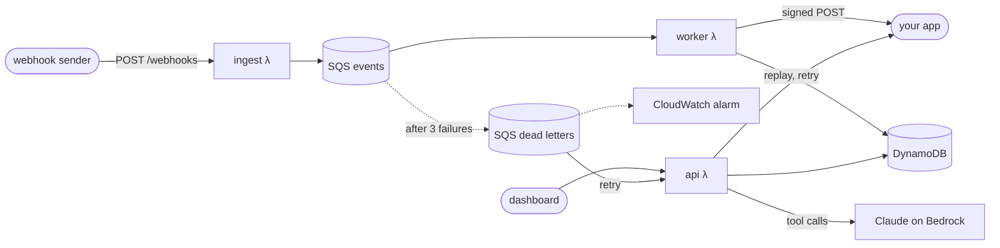

<h1 align="center">tailhook</h1>

<p align="center">
  A webhook debugger for payment events, with an agent that tells you why a charge failed.
</p>

<p align="center">
  <a href="https://github.com/NathanYearout/tailhook/actions/workflows/ci.yml"></a>
  
  
  
</p>

<p align="center">
  <a href="https://su5zcwu6yd.execute-api.us-east-2.amazonaws.com"><b>Live demo</b></a> ·
  <a href="#how-duplicates-are-handled">How duplicates are handled</a> ·
  <a href="#results">Load test and evals</a> ·
  <a href="docs/design.md">Design doc</a>
</p>


tailhook sits between a webhook sender and your app. It checks each event's signature, stores
it once no matter how many times it's delivered, forwards it to your app with retries, and
parks events that keep failing in a dead-letter queue.

## What you can do with it

- **Watch events arrive** with their delivery status, decline codes, duplicate counts and
  out-of-order flags.
- **Open any event** to see its payload, every delivery attempt with your app's response, and
  the payment's timeline in the order things actually happened.
- **Break it, then fix it.** The demo's stand-in merchant app has a planted bug: refunds crash
  it with `KeyError: 'original_amount'`. They're retried three times, land in the dead-letter
  queue and trip a CloudWatch alarm. Ship the fix, press Retry dead letters, and they go
  through.
- **Replay a payment** in created order. Replay stops at the first failure, so a refund can't
  overtake the payment it refunds.
- **Ask the agent** things like "why didn't my app get the refund for pay_9Q?" Claude answers
  with four read-only tools over what tailhook recorded, and cites the events it used.

<picture>
  <source media="(prefers-color-scheme: dark)" srcset="docs/screenshots/dead-letter-dark.png">
  
</picture>

## Architecture



Everything is in [`infra/main.tf`](infra/main.tf) and deploys with `make deploy`. The design
doc is [`docs/design.md`](docs/design.md).

## How duplicates are handled

Duplicates come from two places, and they need opposite handling. The sender retries, so the
same `webhook-id` can arrive twice; the second copy should be counted and otherwise ignored.
SQS also delivers at least once, so the worker can see the *same message* twice; if the first
try failed to reach your app, the second try has to deliver it.

A plain "reject if the key exists" write handles the first case and silently breaks the
second. tailhook uses one atomic DynamoDB `UpdateItem` keyed on `webhook-id` instead: it
stores the event if it's new, adds this delivery's receipt ID to a set, and sets `owner` to
that receipt only if no owner exists yet. Whichever receipt owns the event delivers it,
including on SQS retries; every other receipt is just counted. See
[`record_receipt`](app/store.py) and [`worker.process`](app/worker.py).

## Why SQS and DynamoDB

- **SQS between ingest and processing.** Ingest never waits on the database or your app, so a
  slow or broken app can't make the sender time out. Retries and the dead-letter queue come
  from the redrive policy; the worker only sets the backoff between tries.
- **DynamoDB keyed on the idempotency key.** "Have I seen this, and who delivers it?" is one
  conditional write, with no locks and no second round trip. Two indexes cover the reads:
  a payment's events in created order, and the newest events. The newest-events index is
  split across 8 shards because a single partition takes about 1,000 writes per second.
- **Both cost nothing when idle.** A Postgres server would cost money around the clock for a
  demo that's quiet most of the time.

## Results

**Load test** (a separate copy of the stack, 60 seconds, sent from a laptop):

| Events sent | Ingest rate | Ingest p50 / p99 (client side) | Stored | Delivered to the app | Lost |
|---|---|---|---|---|---|
| 60,000 | 996/s | 50 / 119 ms | 60,000 | 60,000 | 0 |

Stored and delivered are counted from the worker's logs with CloudWatch Logs Insights
(`make verify`). Nothing was throttled. Lambda concurrency peaked at 203 for ingest, 97 for
the worker and 45 for the api function, against this account's limit of 400, so that limit
is the next ceiling rather than the code.

**Agent evals**: 18 cases across declines, delivery failures, duplicates and ordering,
questions the data can't answer, and prompt injection hidden in event payloads. Each case's
events run through the real worker into a local DynamoDB (moto), then the agent's answer is
graded by string checks: what it must say, which event IDs it must cite, which tools it must
call, and what it must not say. There's no LLM judge. The cases are in
[`evals/cases.json`](evals/cases.json); `make evals MODEL=haiku` runs them.

## Run it yourself

You need an AWS account, Terraform, and [uv](https://docs.astral.sh/uv/).

```bash
uv sync
make test                                  # unit tests, no AWS needed
echo 'alert_email = "you@example.com"' > infra/terraform.tfvars
make deploy                                # builds the Lambda packages and applies Terraform
make evals MODEL=haiku                     # grades the agent (uses Bedrock, costs a few cents)
```

To repeat the load test, deploy a throwaway copy in its own workspace, then destroy it:

```bash
terraform -chdir=infra workspace new load && make deploy
make load                                  # 1,000 events/s for 60 s, from 8 processes
make verify RUN=<run id printed by make load>
make destroy && terraform -chdir=infra workspace select default
```

The Makefile defaults to the AWS profile `personal` in `us-east-2`; override with
`make deploy AWS_PROFILE=... AWS_REGION=...`. Every route is throttled and Terraform adds a
$5 monthly budget alert, but the demo is public, so set a spend limit on the account too.

## What I'd build next

- Bulk replay through an SQS FIFO queue grouped by payment, so ordering holds for thousands of
  events instead of one payment at a time.
- Multiple destinations, each with its own URL and signing secret.
- Adapters for real providers' webhook formats.
- Streaming agent answers.
- Deploys from CI with GitHub OIDC instead of from a laptop.
