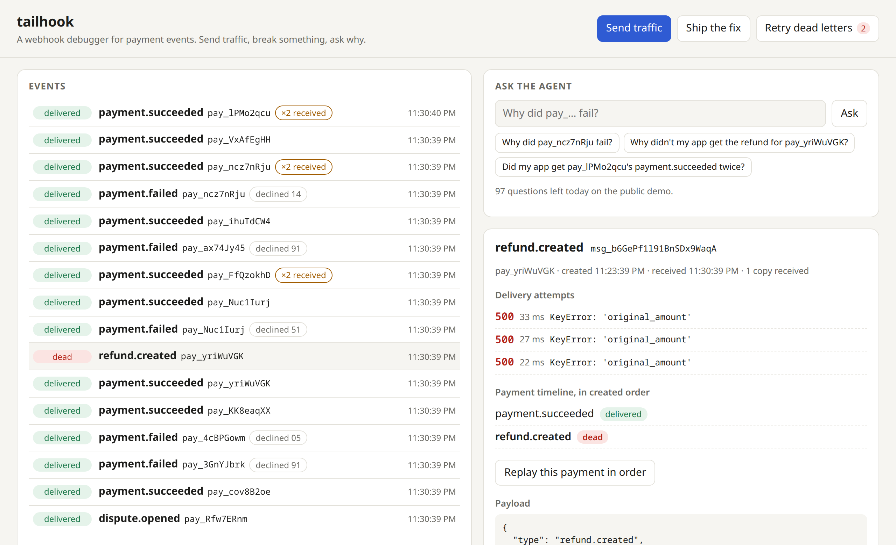
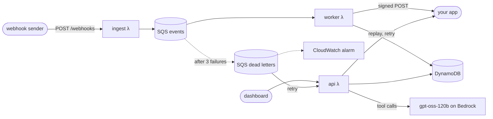

<h1 align="center">tailhook</h1>

<p align="center">
  A webhook debugger for payment events, with an agent that tells you why a charge failed.
</p>

<p align="center">
  <a href="https://github.com/NathanYearout/tailhook/actions/workflows/ci.yml"></a>
  
  
  
</p>

<p align="center">
  <a href="https://su5zcwu6yd.execute-api.us-east-2.amazonaws.com"><b>Live demo</b></a> ·
  <a href="#how-duplicates-are-handled">How duplicates are handled</a> ·
  <a href="#results">Load test and evals</a> ·
  <a href="docs/design.md">Design doc</a>
</p>


tailhook sits between a webhook sender and your app. It checks each event's signature, stores
it once no matter how many times it's delivered, forwards it to your app with retries, and
parks events that keep failing in a dead-letter queue.

## What you can do with it

- Watch events come in, with their delivery status, decline codes, duplicate counts and
  out-of-order flags.
- Open an event to see its payload, every delivery attempt with your app's response, and the
  payment's timeline in the order things actually happened.
- Break it and fix it. The demo merchant app crashes on refunds with
  `KeyError: 'original_amount'`, so they retry three times, land in the dead-letter queue and
  set off a CloudWatch alarm. Ship the fix, hit Retry dead letters, and they go through.
- Replay a payment in created order. Replay stops at the first failure, so a refund can't
  overtake its payment.
- Ask the agent things like "why didn't my app get the refund for pay_9Q?". It answers with
  four read-only tools over what tailhook recorded, cites the events it used, and turns down
  anything that isn't about your webhooks.

<picture>
  <source media="(prefers-color-scheme: dark)" srcset="docs/screenshots/dead-letter-dark.png">
  
</picture>

## Architecture



Everything is in [`infra/main.tf`](infra/main.tf). Every push to `main` deploys it from
GitHub Actions once the tests pass, and `make deploy` does the same from a laptop. The design
doc is [`docs/design.md`](docs/design.md).

## How duplicates are handled

Duplicates come from two places, and they need opposite handling. The sender retries, so the
same `webhook-id` can arrive twice; the second copy should be counted and otherwise ignored.
SQS also delivers at least once, so the worker can see the *same message* twice; if the first
try failed to reach your app, the second try has to deliver it.

A plain "reject if the key exists" write handles the first case and silently breaks the
second. tailhook uses one atomic DynamoDB `UpdateItem` keyed on `webhook-id` instead: it
stores the event if it's new, adds this delivery's receipt ID to a set, and sets `owner` to
that receipt only if no owner exists yet. Whichever receipt owns the event delivers it,
including on SQS retries; every other receipt is just counted. See
[`record_receipt`](app/store.py) and [`worker.process`](app/worker.py).

## Delivery guarantees

Delivery is at least once. A worker can crash after your app answers but before tailhook
writes that down, and replays re-send on purpose. Every delivery keeps the sender's
`webhook-id` and is signed with tailhook's own secret, so verify the signature and dedupe on
the id.

Duplicates are caught for 7 days, which is how long events stay in the table (DynamoDB TTL).
A sender retry inside that window is counted and dropped; one that shows up later looks like
a new event.

Once an event is dead-lettered, more copies from the sender are only counted, and nothing
reaches your app until someone retries the dead letters or replays the payment. Dead letters
are kept for 14 days, and a retry can still deliver one after its row has expired. If a
replay and a worker retry race, a failed attempt never flips a delivered event back to
retrying.

Live deliveries aren't ordered: the queue and the workers run in parallel, so your app can
get a refund before its payment. Replay is the ordered path. It sends a payment's events in
created order and stops at the first failure.

## Why SQS and DynamoDB

SQS sits between ingest and processing so ingest never waits on the database or on your app.
A slow or broken app can't make the sender time out. Retries and the dead-letter queue come
from the redrive policy; the worker only sets the backoff between tries.

DynamoDB is keyed on the idempotency key, so "have I seen this, and who delivers it?" is one
conditional write, with no locks and no second round trip. Two indexes cover the reads: a
payment's events in created order, and the newest events overall. The newest-events index is
spread over 8 shards because one partition tops out around 1,000 writes a second.

Both cost nothing when idle, which matters for a demo that's quiet most of the time. A
Postgres instance would bill around the clock.

## Results

### Load test

Sent from a laptop to a separate copy of the stack for 60 seconds:

| Events sent | Ingest rate | Ingest p50 / p99 (client side) | Stored | Delivered to the app | Lost |
|---|---|---|---|---|---|
| 60,000 | 996/s | 50 / 119 ms | 60,000 | 60,000 | 0 |

Stored and delivered are counted from the worker's logs with CloudWatch Logs Insights
(`make verify`). Nothing was throttled. Lambda concurrency peaked at 203 for ingest, 97 for
the worker and 45 for the api function, against this account's limit of 400, so a bigger test
would hit the account limit before the code became the bottleneck.

### Agent evals

Twenty cases cover declines, delivery failures, duplicates and ordering, questions the
data can't answer, prompt injection hidden in event payloads, and off-topic requests. Each case's
events run through the real worker into a local DynamoDB (moto), then the agent's answer is
graded by string checks: what it must say, which event IDs it must cite, which tools it must
call, and what it must not say. There's no LLM judge. The cases are in
[`evals/cases.json`](evals/cases.json); `make evals` runs them. gpt-oss-120b passed all 20 in
the run saved in [`evals/results/gpt-oss.json`](evals/results/gpt-oss.json), at a median of
1.4 s and $0.0004 a question.

## Run it yourself

You need an AWS account, Terraform, and [uv](https://docs.astral.sh/uv/). Terraform keeps its
state in S3, so first point the `backend "s3"` block in [`infra/main.tf`](infra/main.tf) at a
bucket you own.

```bash
uv sync
make test                                  # unit tests, no AWS needed
echo 'alert_email = "you@example.com"' > infra/terraform.tfvars
make deploy                                # builds the Lambda packages and applies Terraform
make evals                                 # grades the agent (uses Bedrock, costs about a cent)
```

To repeat the load test, deploy a throwaway copy in its own workspace, then destroy it:

```bash
terraform -chdir=infra workspace new load && make deploy
make load                                  # 1,000 events/s for 60 s, from 8 processes
make verify RUN=<run id printed by make load>
make destroy && terraform -chdir=infra workspace select default
```

The Makefile defaults to the AWS profile `personal` in `us-east-2`; override with
`make deploy AWS_PROFILE=... AWS_REGION=...`. Every route is throttled and Terraform adds a
$5 monthly budget alert, but the demo is public, so set a spend limit on the account too.

## What I'd build next

- Bulk replay through an SQS FIFO queue grouped by payment, so ordering holds for thousands of
  events instead of one payment at a time.
- Multiple destinations, each with its own URL and signing secret.
- Adapters for real providers' webhook formats.
- Streaming agent answers.
- GitHub OIDC for deploys instead of an access key, once this AWS account's plan allows
  identity providers.
